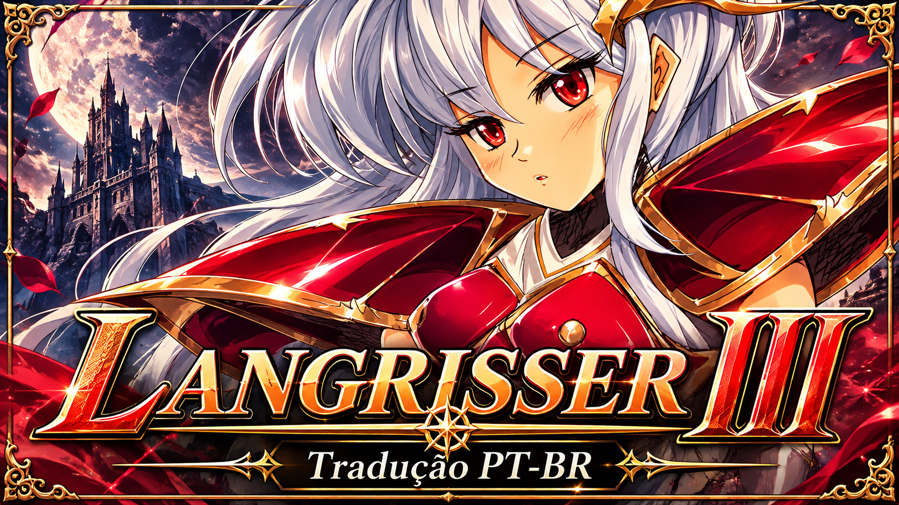

  

# Langrisser III — tradução PT-BR

Projeto de fã para traduzir *Langrisser III* (Sega Saturn, Japão) para português brasileiro. Os 144 nomes de arquivos `.txt` da base inglesa delimitam o inventário de destinos; o conteúdo, as linhas e os marcadores são traduzidos e validados a partir do japonês. A meta é preservar o sentido e o tom de cada cena em uma fala que soe natural no Brasil.

**Progresso geral:** o inventário fechado da base do patcher contém 144 arquivos `.txt` em `scripts/en`. Há 36 arquivos PT-BR traduzidos, revisados e publicados (25% por contagem de arquivos) e 108 pendentes. O percentual não mede volume de palavras. O jogo inteiro **não** está traduzido.

**Plano da primeira versão:** o texto dentro do jogo será inicialmente sem acentos. O suporte completo à acentuação fica para uma etapa futura, condicionada ao apoio e às doações. Os roteiros aprovados permanecem intactos.

**[Abrir a página do projeto](https://mirumadev-jpg.github.io/langrisser3-ptbr/)** · **[Ver o inventário dos 144 arquivos](docs/PTBR_TEXT_BACKLOG.md)** · **[Ver os créditos](CREDITS.md)** · **[Ver os roteiros](scripts/pt-br/)**

## Sobre Mim

Sou Miruma: dev solo, artista, compositor e escritor. Estou trabalhando em jogos comerciais e gratuitos. Resolvi traduzir *Langrisser III* porque amo a franquia e quero aproximar essa obra do público brasileiro.

Há milhões de anos (risos), a arte de Satoshi Urushihara me inspirou a desenhar. É uma honra trazer uma obra cuja identidade visual me marcou para mais perto de quem fala português. Também sou entusiasta de jogos com romances possíveis; esse tipo de relação entre personagens me encanta e certamente vai aparecer nos meus próprios jogos.

## Progresso da tradução do jogo

| Família de arquivos | Concluído | Situação |
|---|---:|---|
| Total de arquivos-alvo | 36 de 144 · 25% | 108 arquivos pendentes |
| Roteiros de batalha (`scen001`–`scen036`) | 36 de 36 | Traduzidos, revisados e aprovados |
| Demais roteiros (`scen037`–`scen125`) | 0 de 89 | Pendentes de tradução e revisão |
| Menus, sistema e itens (`fntsys1`–`fntsys15`) | 0 de 15 | Pendentes; `fntsys10` contém nomes e `fntsys13` descrições de itens |
| Progressão, magia, habilidade e janela (`plot`, `prog3_magic`, `prog3_skill`, `syswin`) | 0 de 4 | Pendentes |

O escopo e os estados por arquivo estão no [inventário completo](docs/PTBR_TEXT_BACKLOG.md). A lista inglesa define somente os arquivos-alvo; as traduções e os marcadores são conferidos com as fontes japonesas. A contagem é por arquivo, não por volume de texto.

Ver a lista dos 36 roteiros de batalha aprovados

- Cenário 1 — tradução revisada e aprovada.
- Cenário 2 — tradução revisada e aprovada.
- Cenário 3 — tradução revisada e aprovada.
- Cenário 4 — tradução revisada e aprovada.
- Cenário 5 — tradução revisada e aprovada.
- Cenário 6 — tradução revisada e aprovada.
- Cenário 7 — tradução revisada e aprovada.
- Cenário 8 — tradução revisada e aprovada.
- Cenário 9 — tradução revisada e aprovada.
- Cenário 10 — tradução revisada e aprovada.
- Cenário 11 — tradução revisada e aprovada.
- Cenário 12 — tradução revisada e aprovada.
- Cenário 13 — tradução revisada e aprovada.
- Cenário 14 — tradução revisada e aprovada.
- Cenário 15 — tradução revisada e aprovada.
- Cenário 16 — tradução revisada e aprovada.
- Cenário 17 — tradução revisada e aprovada.
- Cenário 18 — tradução revisada e aprovada.
- Cenário 19 — tradução revisada e aprovada.
- Cenário 20 — tradução revisada e aprovada.
- Cenário 21 — tradução revisada e aprovada.
- Cenário 22 — tradução revisada e aprovada.
- Cenário 23 — tradução revisada e aprovada.
- Cenário 24 — tradução revisada e aprovada.
- Cenário 25 — tradução revisada e aprovada.
- Cenário 26 — tradução revisada e aprovada.
- Cenário 27 — tradução revisada e aprovada.
- Cenário 28 — tradução revisada e aprovada.
- Cenário 29 — tradução revisada e aprovada.
- Cenário 30 — tradução aprovada e publicada.
- Cenário 31 — tradução aprovada e publicada.
- Cenário 32 — tradução aprovada e publicada.
- Cenário 33 — tradução aprovada e publicada.
- Cenário 34 — tradução aprovada e publicada.
- Cenário 35 — tradução aprovada e publicada.
- Cenário 36 — tradução revisada, aprovada e publicada.

Os 36 arquivos publicados em [`scripts/pt-br/`](scripts/pt-br/) são os roteiros das batalhas. Eles preservam a sequência de códigos de controle e placeholders do roteiro japonês; a versão inglesa é usada apenas para delimitar o inventário de destinos, nunca como fonte de tradução.

## Nota de terminologia

Em PT-BR, usamos **magia/magias**, **conjurar magia** ou **fazer magia** para poderes sobrenaturais. **Mágica** fica para truques de palco e ilusionismo, a menos que o contexto peça outra coisa.

Também priorizamos expressões que soem naturais no Brasil e preservem a voz de cada personagem: por exemplo, “fazer bico” em vez de “fazer beiço” e “não tenho noção de direção” em vez de uma construção literal. Em objetivos com peso narrativo, preferimos “civis” a rótulos técnicos como “NPCs”, para não quebrar a imersão. No cenário 5, a fala afetuosa e levemente ciumenta de Tiaris usa “bobo”; nos diários, usamos “recém-nomeado” para o cavaleiro e “as coisas não têm sido fáceis” para o relato da Runa.

Interjeições e onomatopeias também devem soar brasileiras: adaptar sons como “Kuh” para “Urgh!”, “Ugh!” ou outra forma natural conforme a fala, em vez de transliterá-los mecanicamente.

## Notas técnicas

A base técnica é o release [v0.8.0 do Langrisser III English Patch](https://github.com/hexerkat/langrisser3-english/releases/tag/v0.8.0), usado como referência para adaptar o builder. O inventário de trabalho contém seus 144 arquivos `.txt`; os 36 roteiros de batalha estão completos e 108 arquivos-alvo continuam pendentes. O japonês é a autoridade para conteúdo, estrutura e marcadores. Este repositório não contém um patch aplicável.

Antes de uma build PT-BR serão necessários, no mínimo:

- adaptar o builder para localizar os roteiros PT-BR e validar sua estrutura e seus marcadores contra os arquivos japoneses;
- adaptar o pipeline para que a primeira versão do texto dentro do jogo seja sem acentos, sem reescrever os roteiros aprovados; suporte completo a acentos e cedilha fica para uma etapa futura, condicionada às doações;
- traduzir os 108 arquivos pendentes do inventário: 89 roteiros `scen`, 15 recursos `fntsys` e 4 arquivos de progressão/tabelas/janelas;
- executar QA de layout da versão inicial sem acentos e testar o resultado no jogo;
- validar o pipeline de build para PT-BR.

O patcher pronto do release é voltado à versão inglesa. Nenhum arquivo de jogo, ROM, ISO, binário, música, vídeo ou arte extraída é distribuído neste repositório. Para jogar, é necessário possuir uma cópia legítima do disco japonês.

## Próxima fase: completar os textos e preparar o patcher

O próximo foco é traduzir os 108 arquivos pendentes, começando por nomes e descrições de itens (`fntsys10` e `fntsys13`), seguindo pelos demais recursos de sistema/UI e, então, pelas outras famílias do [inventário](docs/PTBR_TEXT_BACKLOG.md). A primeira versão será planejada sem acentos; a versão acentuada fica para uma fase posterior, se houver apoio suficiente. Depois, o builder v0.8.0 será adaptado e testado localmente com uma cópia legítima e compatível do disco japonês. A ferramenta e o patch só serão considerados prontos após validar todos os textos, o layout e o funcionamento no jogo.

## Créditos

Agradecimentos ao projeto [Langrisser III English Patch](https://github.com/hexerkat/langrisser3-english), a `hexerkat` pela manutenção e autoria da versão inglesa atual, e a `ralfguth`, autor original do patch-base e de partes fundamentais da ferramenta. Os créditos herdados completos estão em [CREDITS.md](CREDITS.md).

A arte de Satoshi Urushihara, designer de personagens de *Langrisser III*, inspirou Miruma a desenhar e é uma das razões afetivas deste projeto.

## Licença e aviso

Este repositório mantém a licença GPL-3.0 já presente. A licença cobre apenas o material a que seus autores podem conceder direitos; não licencia *Langrisser III* nem seus elementos protegidos. Este é um projeto de fã, não oficial e sem afiliação, patrocínio ou endosso de Masaya, NCS ou dos titulares dos direitos.
